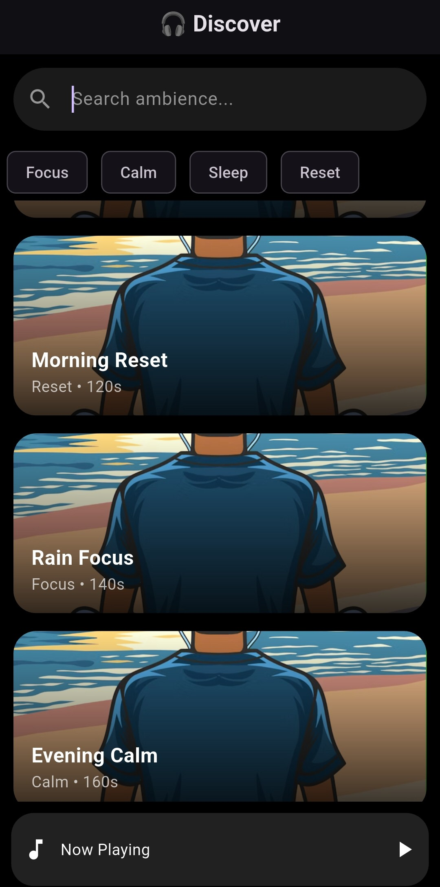
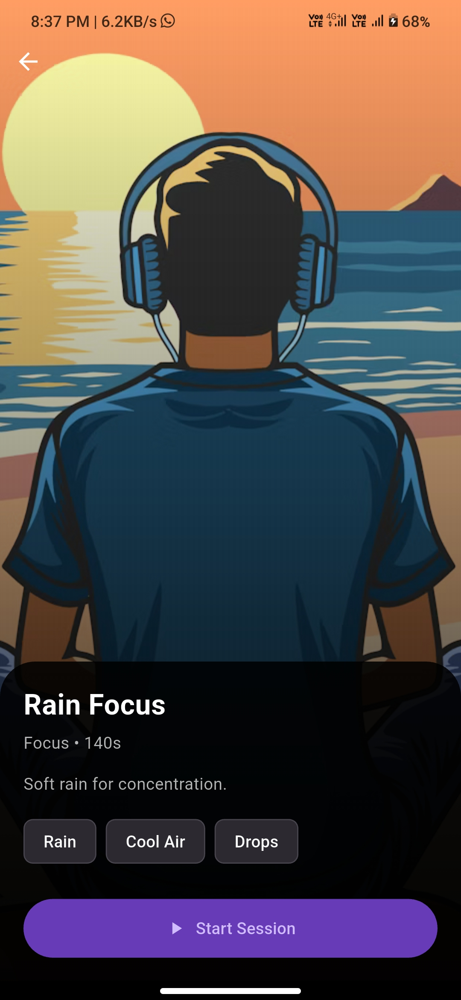
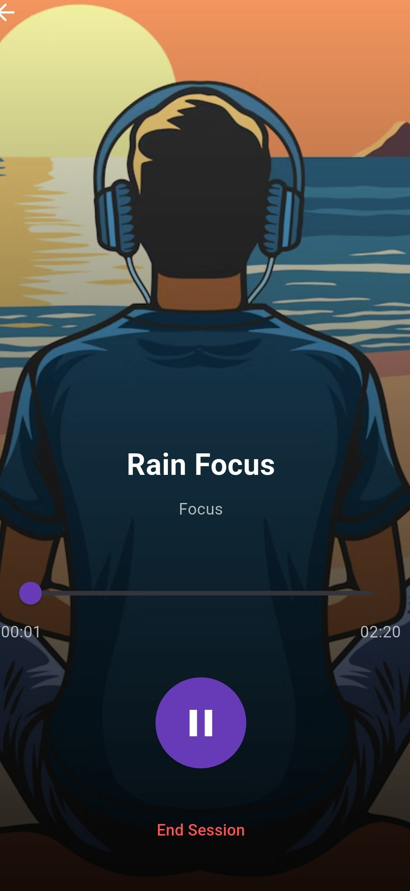

# 🎧 Arvyax Ambience App

A modern **Flutter-based ambience & relaxation app** designed to help users focus, relax, and reflect through immersive soundscapes and journaling.

---

## ✨ Features

* 🎵 **Ambient Audio Sessions**

  * Forest, Rain, Ocean, Sleep sounds
  * Looping background audio using `audioplayers`

* 🧘 **Session Player**

  * Play / Pause / Resume functionality
  * Real-time progress tracking
  * Auto session completion

* 🌄 **Modern UI**

  * Clean & minimal design
  * Gradient-based theme
  * Smooth navigation

* 🔍 **Search & Filter**

  * Search ambiences by name
  * Filter using tags (Focus, Calm, Sleep, Reset)

* 📓 **Journal / Reflection**

  * Write thoughts after each session
  * Select mood (Calm, Energized, etc.)
  * Save reflections locally

* 📜 **History Screen**

  * View past reflections
  * Tap to read full entry

---
* 🌄 **Screenshots**
<h2 align="center">📱 App Preview</h2>

<p align="center">
 
 
 
</p>

## 📁 Project Structure

```
lib/
│
├── data/
│   ├── models/
│   │   ├── ambience_model.dart
│   │   ├── journal_model.dart
│   │   └── repositories/
│   │       ├── ambience_repository.dart
│   │       └── journal_repository.dart
│
├── features/
│   └── ambience/
│       ├── ambience_screen.dart
│       ├── ambience_details_screen.dart
│       ├── player/
│       │   ├── player_controller.dart
│       │   ├── session_player_screen.dart
│       │   └── mini_player.dart
│       └── journal/
│           ├── journal_screen.dart
│           ├── journal_controller.dart
│           └── history_screen.dart
│
├── shared/
│   └── theme/
│       └── app_theme.dart
│
└── main.dart
```

---

## 📦 Assets Setup

Make sure assets are placed correctly:

```
assets/
├── images/
│   └── sample.png
├── audio/
│   └── sample.mp3
└── ambiences.json
```

---

## ⚙️ pubspec.yaml

```yaml
flutter:
  assets:
    - assets/images/
    - assets/audio/
    - assets/ambiences.json
```

---

## 🚀 How to Run

1. Clone the repository
2. Navigate to project folder
3. Run:

```bash
flutter pub get
flutter run
```

---

## 🎯 Technologies Used

* Flutter
* Dart
* Provider (State Management)
* audioplayers package

---

## 🧠 Key Learnings

* State management using Provider
* Audio handling in Flutter
* UI/UX design principles
* JSON data parsing
* Navigation & screen flow

---

## 📌 Future Improvements

* 🔥 Persistent storage using SharedPreferences
* 🎧 Multiple audio tracks support
* 🌙 Dark / Light theme toggle
* ☁️ Cloud sync for journals
* 🎨 Advanced animations

---

## 👩‍💻 Author

**DheerajPandey88**

---

## ⭐ Conclusion

This project demonstrates a complete Flutter application with:

* Clean architecture
* Functional features
* User-friendly interface

Built with focus on **real-world usability and smooth experience**.

---
